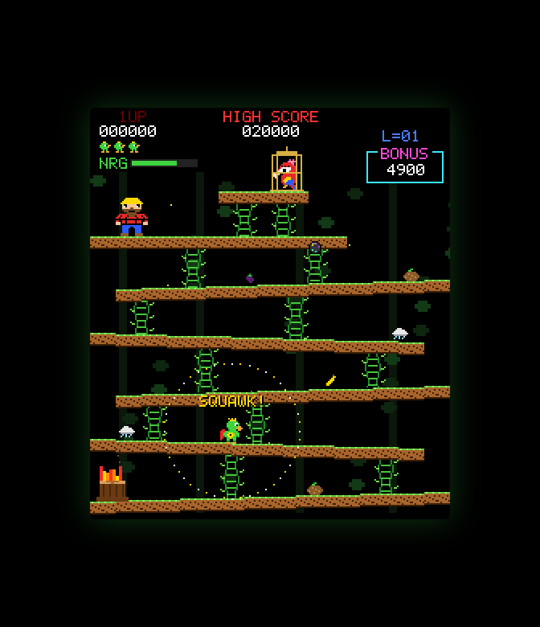

# Lord B: Save the Rainforest

A 1982-style arcade game: Lord B, the green Amazon parrot superhero, climbs the vines of the Mata Atlantica (Brazil's Atlantic rainforest) to free Lady Macaw and her friends from the Big Logger, dodging oil barrels, oil slicks, forest fires, falling logs and chainsaw loggers. Throw seed bombs to plant trees, use the Jungle Squawk and the Parrot Dash.

Play it at https://hh297.github.io/lord-b-game/

Controls: arrows/WASD move & climb, Space jump (hold to fly), Shift sprint, Z/J Jungle Squawk, X/K Seed Bomb, C/L Parrot Dash, P pause, M mute, T scanlines. Touch buttons on phones.

